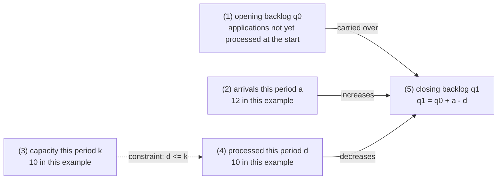
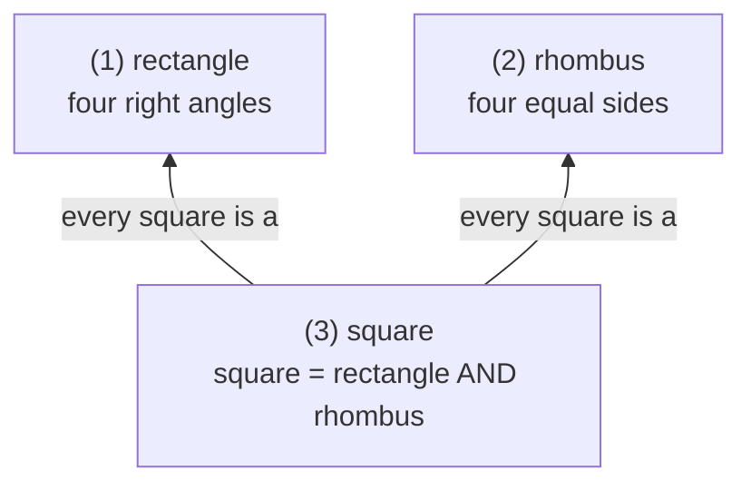

# Register samples: one lens, different shapes of knowledge

The two fictional teaching fragments below show how the structure follows the relations. They calibrate the register only — they are not a layout, subject matter, or node list to copy.

## Example 1: an application backlog is a set of stock-and-flow relations

**Input material**: in one hour a counter received 12 applications and processed 10; under the current process it can process at most 10 per hour. The existing backlog and this hour's arrivals must be counted separately. If arrivals keep exceeding processing capacity, the backlog grows. Raising capacity may help, but the actual throughput and the quality still have to be checked.

**Structure seen**: arrivals and processing change the backlog; capacity constrains actual throughput. The diagram is organized around quantitative relations, with the figures marked next to the matching variables.

Same period, same type of application, everything counted in "applications". This example ignores other ins and outs such as withdrawals and transfers; where those exist, they have to be added to the accounting.



### (1) Opening backlog: applications already waiting when the period starts

```
q0 := number of applications already received but not yet processed at the start
```

This is a stock. The material gives no figure for it, so it stays unknown; the 12 arriving each hour must not be treated as the existing backlog.

### (2) Arrivals this period: applications entering during this period

```
a := number of applications entering this period = 12
```

It increases the total waiting to be processed. The 12 is this hour's record; it says nothing about every later hour being 12.

### (3) Capacity this period: the most that can be processed under current conditions

```
k := maximum number processable this period under the current process = 10
```

It caps actual throughput: d <= k. A cap of 10 does not guarantee 10 were processed; capacity and output are two different things.

### (4) Processed this period: what was actually completed

```
d := number actually completed this period = 10
```

This is the recorded output. Whether raising k actually raises d requires new records — a higher capacity target is no substitute for observation.

### (5) Closing backlog: the carried-over amount plus the net change

```
q1 := number still unprocessed at the end = q0 + a - d
```

Substituting this example: q1 = q0 + 2. How large the backlog is in absolute terms remains unknown, but the increase of 2 in this hour follows from the records.

The same equation also gives a discrimination criterion: within the counting boundaries above, q1 > q0 if and only if a > d. Two situations both called "a serious backlog" may be a large existing stock or a continuing net inflow; different observables lead to different follow-up judgments.

To check whether an adjustment worked, you could separately track "the backlog falls as agreed while quality holds". The source gives no threshold or review window, so this extra check need not become a uniform endpoint of the main diagram.

## Example 2: rectangles and rhombuses are a set of crossing classifications

**Input material**: a rectangle requires four right angles; a rhombus requires four equal sides; a square satisfies both sets of conditions. So one figure can be both a rectangle and a rhombus — the two names do not exclude each other.

**Structure seen**: two criteria intersect, and the intersection is the square. A set relation fits here; no "application - verification - feedback" flow needs to be added.

This example concerns ordinary non-degenerate simple plane quadrilaterals. The arrows mark containment, not order of generation or causation.



| Node | Definition and formula | Concrete semantics |
|---|---|---|
| (1) rectangle | `rectangle := {quadrilaterals: all four angles are right angles}` | A sheet of paper with adjacent sides 2 and 3 satisfies it; the criterion looks at the angles, not at whether the figure sits horizontally. The sheet of paper is an added example. |
| (2) rhombus | `rhombus := {quadrilaterals: all four sides are equal}` | A rhombus with adjacent angles of 60 and 120 degrees belongs to this class but is not a rectangle; that figure is an added boundary example. |
| (3) square | `square := rectangle AND rhombus` | The intersection requires both sets of conditions at once. A square falls into both classes; classification need not be mutually exclusive. |

Once an object is judged to be a square, the two containment relations give that it is a rectangle and a rhombus; knowing only that it is a rectangle does not give back a square. Concrete objects and discrimination criteria both do work in the diagram, but they need not be laid out as three separate layers.

## Register

- `efficiency = ability x effort x process` adds only the appearance of a formula when there is no definition of the quantities, no units, and no grounds.
- Drawing every article as "experience -> abstraction -> concept -> learned" lets the analytic framework hide the knowledge in the material.
- Renaming "concrete layer / concept layer / application layer" with synonyms still leaves the fixed layout in place. What actually changes is which relations organize the diagram.

A map passes when the source's own objects stand in the diagram, the edges express the relations they really have, and the definitions and examples make those relations understandable and checkable.
