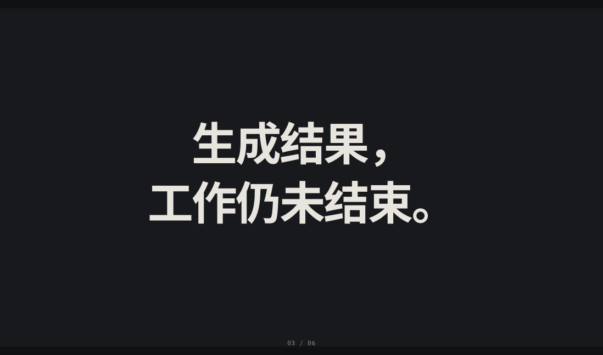
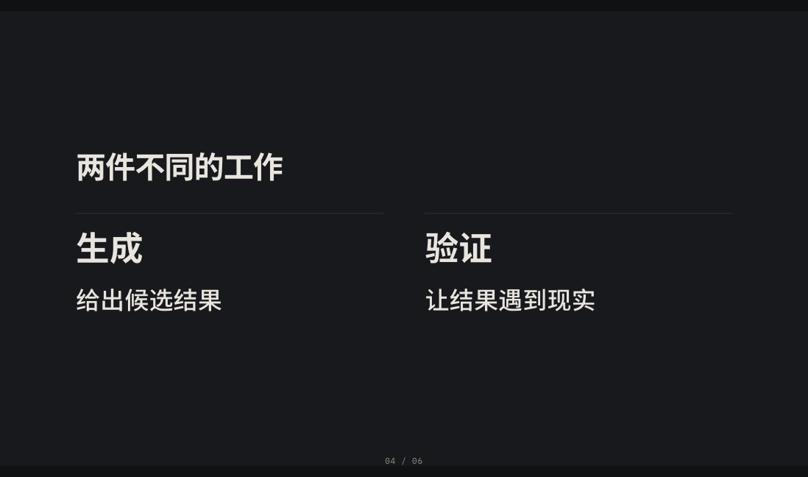
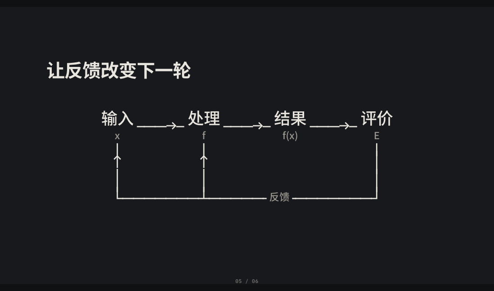
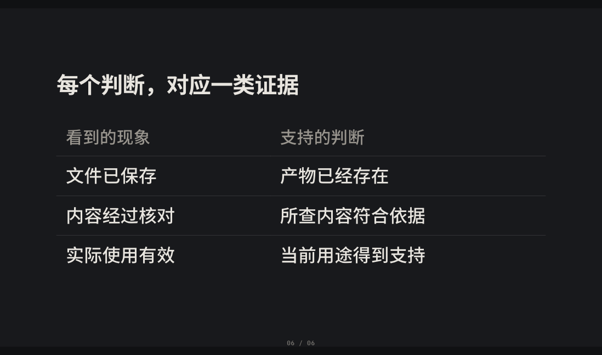

# Composition Reference

The five samples here use one set of constructed content to show how the same visual language serves different speaking functions. They are a reference for comparison, not a quota of layouts to rotate through.

The sample PNGs were rendered from the original edition, so the text in them is in Chinese; read them for composition, and rebuild them from the JSON for English content.

Full data: [CompositionDeck.json](References/CompositionDeck.json). To reproduce:

    bun Tools/BuildDeck.ts References/CompositionDeck.json /tmp/composition-reference.html

The cover is generated from the document title; the five slides that follow are chapter, statement, compare, loop and evidence.

## Statement

The claim carries its own title. Two lines are still one judgment; size, the pause and the surrounding space form the focus together - no synonymous caption is added.

## Compare

Both sides share a baseline, a type size and the dimension being compared. Category and explanation form two levels, and a local hairline does the separating; there is no outer frame and no third summary block.

## Relation

A Unicode loop sends feedback back into the input and the processing. Nodes are set in natural type, with variables close to them. Check whether the arrowheads are complete, whether the loop closes, and whether any line crosses an unrelated label.

## Evidence

The table carries the information structure, with the slide's claim on the same axis as the evidence. Keep only the horizontal rules that do work, and avoid per-cell borders and window chrome. The example is constructed qualitative material, not a real business record.

## Chapter

A new question gets its pause. The proportions of the chapter locator, the main sentence and the space differ from the body; a decorative image and a long lead-in are both unnecessary.

## How to use this

Pick the sample matching this slide's speaking function, then check the protagonist, the reading order, the proportions and the space. Different content may change the line breaks, the pagination or the node positions, but do not let every slide degenerate back into "title + body + explanation".

The samples' sources, layout and scripts can all be reproduced from the JSON and the current template; copying a screenshot or an old HTML file alone loses the verifiable content contract. Check type sizes and boundaries with ProbeDeck, and judge the visual relations from real screenshots.
